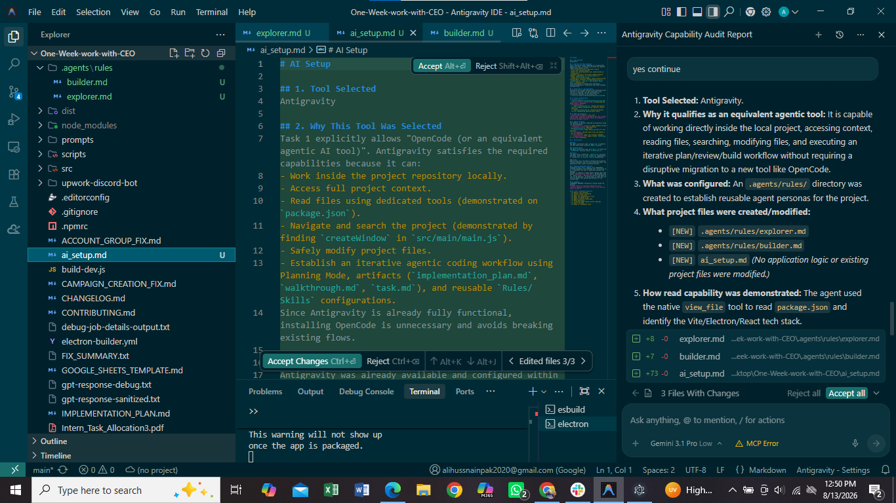

# AI Setup

## 1. Tool Selected
Antigravity

## 2. Why This Tool Was Selected
Task 1 explicitly allows "OpenCode (or an equivalent agentic AI tool)". Antigravity satisfies the required capabilities because it can:
- Work inside the project repository locally.
- Access full project context.
- Read files using dedicated tools (demonstrated on `package.json`).
- Navigate and search the project (demonstrated by finding `createWindow` in `src/main/main.js`).
- Safely modify project files.
- Establish an iterative agentic coding workflow using Planning Mode, artifacts (`implementation_plan.md`, `walkthrough.md`, `task.md`), and reusable `Rules/Skills` configurations.
Since Antigravity is already fully functional, installing OpenCode is unnecessary and avoids breaking existing flows.

## 3. Installation / Existing Setup
Antigravity was already available and configured within the user's environment. No new installation from scratch was required. The IDE environment was successfully attached to the project root:
`c:\Users\kcv\OneDrive\Desktop\One-Week-work-with-CEO`

## 4. Project Configuration
- **Project Root:** `c:\Users\kcv\OneDrive\Desktop\One-Week-work-with-CEO`
- **Project-Level AI Configuration:** Established the `.agents/rules/` directory.
- **Created Rules:**
  - `.agents/rules/explorer.md`: Defined the Explorer role for codebase navigation and read-only context gathering.
  - `.agents/rules/builder.md`: Defined the Builder role for implementing approved plans safely.

## 5. Model Configuration
- **Model Used:** Gemini 3.1 Pro (Low)
*(Note: Model selection is managed by the user's global IDE settings. Different models cannot be assigned to different sub-agent rules.)*

## 6. Agentic Workflow
The workflow is natively supported by Antigravity using its "Planning Mode":
- **Requirement** -> **Explore** (Read codebase context)
- -> **Analyze & Plan** (Agent generates `implementation_plan.md` artifact)
- -> **Human Review** (Agent pauses and waits for user approval)
- -> **Implement** (Builder edits files and updates a `task.md` checklist)
- -> **Test/Verify** (Agent runs terminal commands)
- -> **Code Review & Fix** (Agent creates `walkthrough.md` for final validation).

## 7. Verification

### Read
The agent successfully read `package.json` to identify the tech stack (Vite, Electron, React, Tailwind).

### Navigate/Search
The agent successfully used `grep_search` to locate the `createWindow` function inside `src/main/main.js`.

### Modify
The agent safely created the `.agents/rules` directory and wrote `explorer.md` and `builder.md`. Additionally, it created this `ai_setup.md` file as documentation.

### Verify
Modifications were verified by checking the successful creation responses from the local filesystem tools. The application logic remains untouched and safe.

## 8. Reusable Agent/Role Workflow
Antigravity does **NOT** support truly independent, isolated sub-agents with hardcoded tool restrictions (e.g., a "Reviewer" bot that is physically blocked from editing). 
Instead, it supports a single highly capable agent that adopts **Reusable Roles (Personas)**. By defining rules in `.agents/rules/`, the user can instruct the agent to "act as the Explorer", at which point it reads the rule file and adopts that persona and workflow for the current task.

## 9. Evidence

