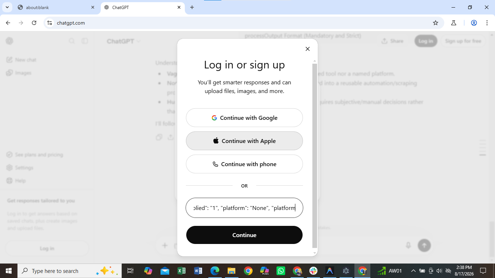
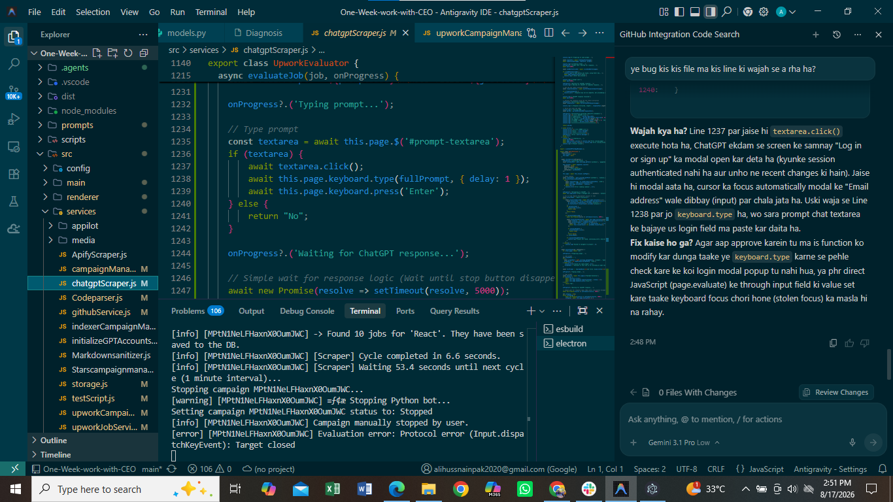

# ChatGPT Scraping Diagnosis

## 1. Problem Summary
The ChatGPT evaluation scraper fails to type the prompt into the chat box. Instead, it pastes the job description into an email input field on a "Log in or sign up" modal that unexpectedly appears.

## 2. Affected Component
- **File**: `src/services/chatgptScraper.js`
- **Function**: `evaluateJob`
- **Relevant Code Location**: Lines 1235-1240

## 3. Broken State Evidence

## 4. Exact Failing Selector
**Selector**: `#prompt-textarea`

**File**: `src/services/chatgptScraper.js`

**Function**: `evaluateJob`

**Why it fails against the actual DOM**: 
The selector itself still exists in the background DOM, so `await this.page.$('#prompt-textarea')` successfully finds an element. However, it fails *functionally* because clicking this element triggers an unauthenticated access modal which overlays the UI and steals keyboard focus, preventing the subsequent typing from reaching the intended textarea.

## 5. Expected vs Actual DOM
**Expected**: 
The `#prompt-textarea` element should be an interactive textarea that receives focus upon being clicked, allowing the script to type the evaluation prompt directly into the chat interface.

**Actual**: 
The `#prompt-textarea` element is present, but interacting with it triggers a dynamic "Log in or sign up" modal to appear in the foreground. The active DOM focus immediately shifts to the `input` field of this modal, causing all keyboard events to target the login form instead.

## 6. Root Cause
1. The scraper assumes that clicking `#prompt-textarea` will focus the chat input for typing without any interruptions.
2. However, ChatGPT now triggers a "Log in or sign up" overlay modal when an unauthenticated user attempts to interact with the chat box, instantly shifting keyboard focus to the modal's email input field.
3. This causes the scraper to blindly type the evaluation prompt into the login field instead of the chat, breaking the automation pipeline.

## 7. Evidence / Verification
The issue was verified via the user-provided screenshot which clearly shows the Puppeteer browser instance stuck on the "Log in or sign up" modal with the job text pasted into the email input. Code inspection confirms that `textarea.click()` is immediately followed by `page.keyboard.type`, which blindly types into whatever element currently has focus (in this case, the dynamically popped-up modal).
